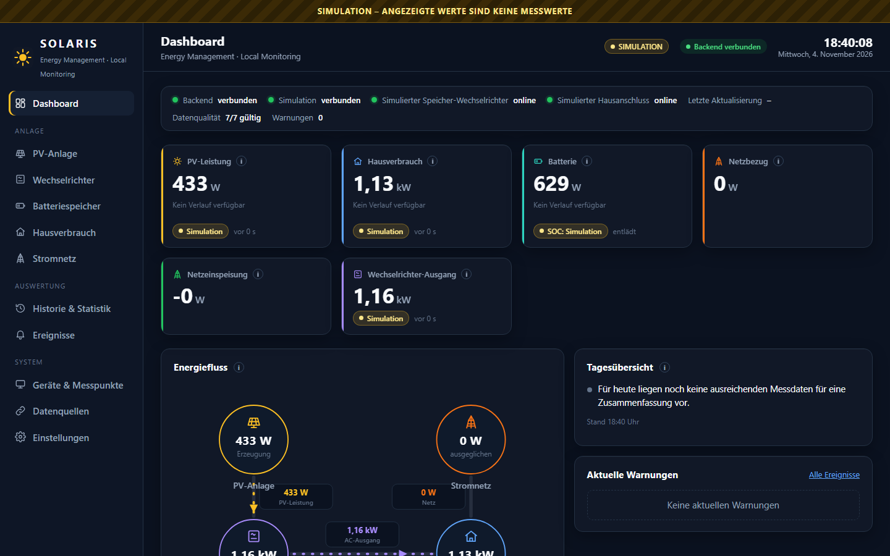
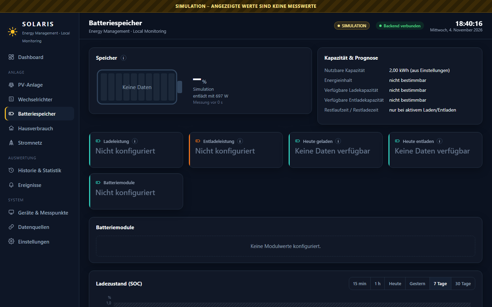
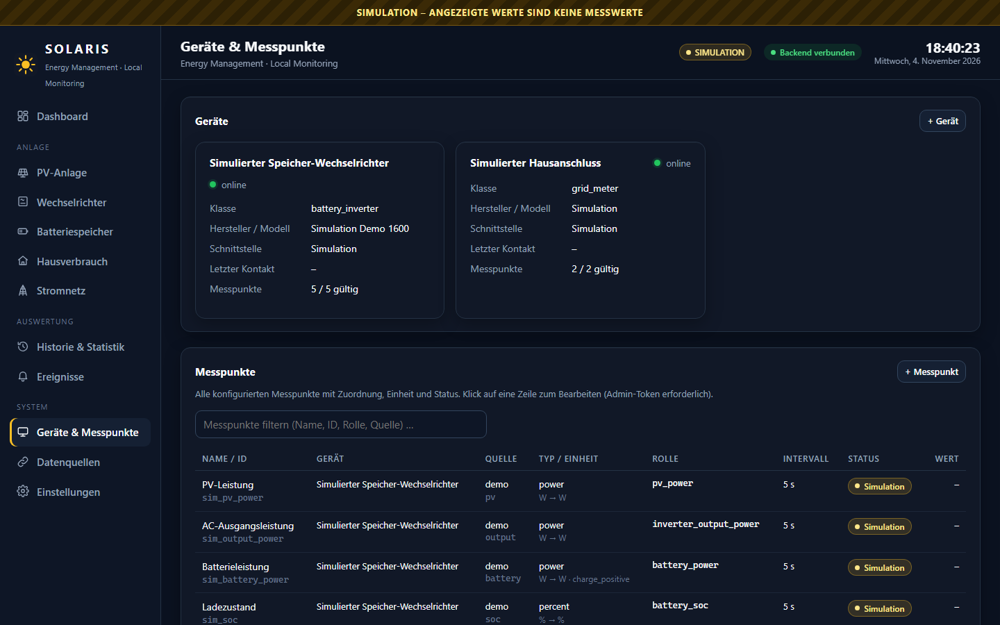
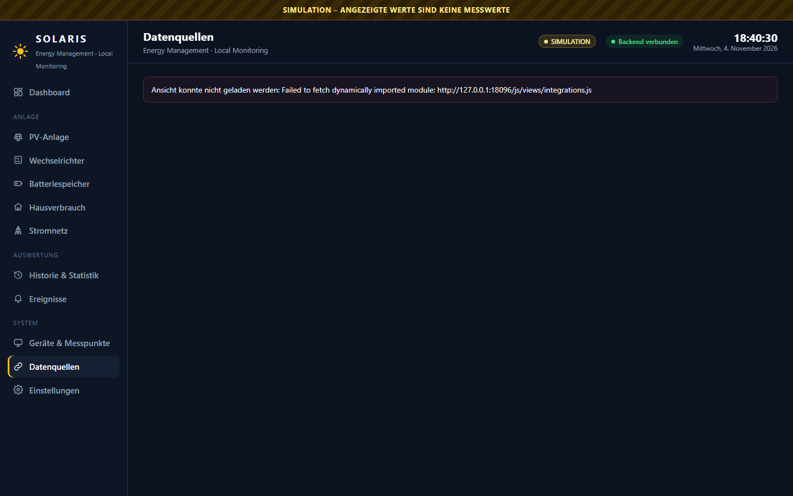

# SOLARIS – lokales Energie-Dashboard

Ein kleines, selbst gehostetes Dashboard für eine PV-Anlage mit Speicher: FastAPI-Backend mit
SQLite-Historie, dazu ein Frontend aus reinem HTML, CSS und JavaScript ohne Build-Schritt.
Die Messwerte kommen wahlweise per **MQTT**, aus **Prometheus** (zum Beispiel dem Export von
Home Assistant), direkt aus der **Home-Assistant-REST-API** oder aus einer eingebauten
**Simulation**, mit der man das Dashboard ohne echte Anlage ausprobieren kann.

Entstanden im Oktober 2026 für ein Balkonkraftwerk mit Growatt-NOAH-Speicher auf einem
Raspberry Pi (Daten über noah-mqtt und Mosquitto, Hausverbrauch aus Home Assistant). Seitdem
läuft es dort rund um die Uhr.



| | |
|---|---|
|  |  |
| Batteriespeicher mit Ladezustand und Leistung | Geräte und Messpunkte mit Rolle, Quelle und Status |
|  | |
| Datenquellen mit Test und Entdecken | |

Alle Bilder zeigen die eingebaute Simulation, keine echten Messwerte.

**Weiterlesen:** [Konfiguration](docs/konfiguration.md) mit allen Feldern, Rollen und Einheiten ·
[Architektur](docs/architektur.md) mit Datenfluss und Designentscheidungen.

## Was es kann

- **Rollenbasierte Messpunkte.** Jeder Messpunkt bekommt eine Rolle wie `pv_power`, `house_power`,
  `battery_soc` oder `grid_power`. Bilanzen, Kennzahlen und Ansichten rechnen nur mit Rollen,
  nie mit Gerätenamen. Deshalb passt dasselbe Dashboard auf jede Anlage.
- **Vier Datenquellen**, beliebig kombinierbar: MQTT (Topic plus optionaler JSON-Pfad), Prometheus,
  Home Assistant REST, Simulation. Jede Quelle kann aus dem Admin-Bereich getestet werden und
  listet ihre verfügbaren Messpunkte auf (`discover`).
- **Historie in SQLite** mit Rohwerten, Stundenwerten und konfigurierbarer Aufbewahrung.
  Unveränderte Werte werden per Heartbeat gespeichert, größere Lücken als Datenlücke markiert.
  Simulierte Werte landen nie in der Historie.
- **Plausibilitätsprüfung.** Weicht die Energiebilanz (PV, Haus, Speicher, Netz) dauerhaft ab,
  entsteht ein Ereignis. Ebenso bei Phasenschieflast, Speichertemperatur oder veralteten Werten.
- **Ansichten**: Übersicht mit Energiefluss, PV, Wechselrichter, Speicher, Netz, Verbrauch,
  Verlauf, Statistik mit Tages-, Wochen-, Monats- und Jahresvergleich, Geräte, Ereignisse.
- **Live** per Server-Sent Events, CSV-Export, Backup und Wiederherstellung der Konfiguration,
  Datenbank-Backup, Rollup-Neuberechnung.
- **Geheimnisse bleiben draußen.** Die Konfiguration kennt nur die *Namen* von Umgebungsvariablen
  (`token_env`, `password_env`), die Werte liegen in `.env`. Der Verwaltungsbereich verlangt
  einen Bearer-Token.

## Schnellstart mit Simulation

```bash
git clone https://github.com/Zedas030/solaris.git && cd solaris
python3 -m venv .venv && . .venv/bin/activate        # Windows: .venv\Scripts\activate
pip install -r requirements.txt
cp data/config/solaris.example.json data/config/solaris.json
cp .env.example .env                                 # SOLARIS_ADMIN_TOKEN eintragen
uvicorn backend.app:app --host 0.0.0.0 --port 8095
```

Danach `http://localhost:8095/` öffnen. Die Beispielkonfiguration hat nur die Simulation aktiv,
sie erzeugt einen plausiblen Tagesverlauf aus Sonne, Hausverbrauch, Speicher und Netz.

## Echte Anlage anbinden

1. In `data/config/solaris.json` eine Integration aktivieren (`mqtt`, `prometheus` oder `homeassistant`)
   und die Zugangsdaten als Umgebungsvariablen in `.env` hinterlegen.
2. Geräte anlegen (`devices`) und Messpunkte (`datapoints`) mit Quelle, Einheit, Typ und Rolle.
   Für `grid_power` und `battery_power` ist die Vorzeichenkonvention Pflicht, damit die Bilanz stimmt.
3. Im Verwaltungsbereich `Integration testen` und `Messpunkte entdecken` nutzen. Die Konfiguration
   wird beim Laden vollständig validiert (Pydantic), Fehler nennen Messpunkt und Ursache.

Mit `tools/backfill_prometheus.py` lässt sich Historie aus Prometheus nachladen, wenn ein Messpunkt
ein `backfill`-Ziel hat.

## Aufbau

```text
backend/
├── app.py                 # FastAPI-App, Lebenszyklus, statisches Frontend
├── api/routes.py          # /api (lesend) und /api/admin (Bearer-Token)
├── integrations/          # base, mqtt, prometheus, homeassistant, demo
├── models/config_models.py# Konfigurationsmodell, Rollen, Validierung
└── services/              # collector, store (SQLite), energy, statistics, events, summary, units
frontend/                  # index.html, css, js/views/*, ohne Framework
data/config/               # solaris.json (lokal), solaris.example.json
tools/backfill_prometheus.py
```

## API (Auszug)

| Methode | Pfad | Zweck |
|---|---|---|
| GET | `/api/health`, `/api/overview`, `/api/system` | Zustand, Kennzahlen, Laufzeitinfos |
| GET | `/api/measurements/current`, `/history`, `/raw` | aktuelle Werte, Verlauf, Rohdaten |
| GET | `/api/statistics`, `/api/statistics/compare`, `/api/summary/today` | Auswertungen |
| GET | `/api/devices`, `/api/integrations`, `/api/events`, `/api/config` | Stammdaten und Ereignisse |
| GET | `/api/stream` | Server-Sent Events |
| GET | `/api/export/csv` | Export |
| POST | `/api/admin/login`, `/validate`, `/integrations/{id}/test`, `/discover` | Verwaltung |
| PUT | `/api/admin/settings` | Einstellungen |
| GET/POST | `/api/admin/backup`, `/restore`, `/db-backup`, `/rollup/reset` | Sicherung |

## Betrieb als Dienst

Auf einem Raspberry Pi oder einem anderen Linux-Rechner hält eine systemd-Unit SOLARIS am Laufen:

```ini
# /etc/systemd/system/solaris.service
[Unit]
Description=SOLARIS Energie-Dashboard
After=network-online.target

[Service]
WorkingDirectory=/opt/solaris
EnvironmentFile=/opt/solaris/.env
ExecStart=/opt/solaris/.venv/bin/uvicorn backend.app:app --host 127.0.0.1 --port 8095
Restart=on-failure
User=solaris

[Install]
WantedBy=multi-user.target
```

Für den Zugriff aus dem Heimnetz am besten einen Reverse-Proxy wie nginx davorsetzen, statt
uvicorn direkt auf `0.0.0.0` zu binden.

## Fehlerbehebung

| Symptom | Ursache und Lösung |
|---|---|
| `/api/overview` liefert 500, im Log `ZoneInfoNotFoundError` | unter Windows fehlt die Zeitzonendatenbank: `pip install tzdata` (steht in `requirements.txt`) |
| Verwaltung meldet 503 | `SOLARIS_ADMIN_TOKEN` ist in `.env` nicht gesetzt |
| Start bricht mit Validierungsfehler ab | Meldung nennt Messpunkt und Feld, häufig eine fehlende `sign_convention` oder eine doppelt belegte Rolle |
| Werte als „veraltet“ markiert | Quelle liefert seltener als `interval`; `interval` oder `stale_after` anpassen |
| Bilanzwarnung ohne echten Fehler | Messpunkte mit `partial: true` kennzeichnen oder `balance_tolerance_*` erhöhen |

## Stand und Grenzen

- Ein Backend-Ordner `tests/` ist angelegt, enthält aber noch keine Tests. Geprüft wurde bisher
  im Betrieb und über die eingebaute Konfigurationsvalidierung.
- Mehrphasige Anlagen werden im Modell unterstützt (`phase_*`-Rollen), waren aber nicht im Einsatz.
- Keine Benutzerverwaltung, nur ein Admin-Token. Für das Heimnetz gedacht, nicht fürs Internet.

## Lizenz

MIT, siehe [LICENSE](LICENSE).
