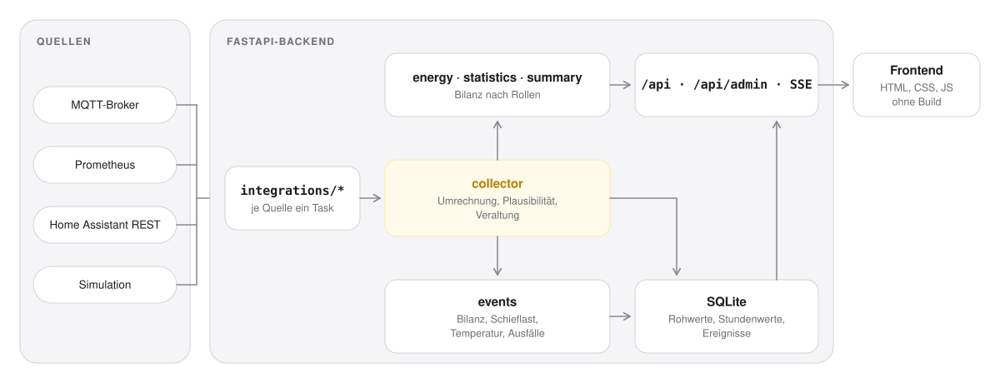

# Architektur

<picture>
  <source media="(prefers-color-scheme: dark)" srcset="assets/architektur-dark.svg">
  
</picture>

## Ablauf

1. **Integrationen** laufen als eigene asyncio-Tasks und liefern `Reading`-Objekte (Messpunkt, Wert,
   Zeitpunkt, simuliert ja/nein) an den Collector. Jede Integration meldet ihren Zustand
   (`connected`, `error`, `disabled`), der in `/api/health` und der Oberfläche erscheint.
2. Der **Collector** rechnet Rohwerte in die interne Einheit um (`scale`, `offset`, `invert`,
   Einheitentabelle), prüft `min`/`max`, markiert veraltete Werte und gibt sie an Speicher und
   Rechenwerk weiter.
3. Der **Store** schreibt in SQLite: ein Rohwert nur bei Änderung oder spätestens nach
   `heartbeat_s`, dazu Stundenwerte als Rollup. Lücken über `max_gap_s` werden als Lücke behandelt,
   nicht interpoliert. Simulierte Werte landen nie in der Datenbank.
4. **Energy, Statistics, Summary** arbeiten nur mit Rollen. Fehlt eine Rolle, fehlt die Kennzahl,
   statt dass ein Wert geschätzt wird.
5. **Events** erkennen dauerhafte Bilanzabweichungen, Phasenschieflast, Temperaturgrenzen und
   Verbindungsabbrüche und speichern sie mit Schweregrad.
6. Das **Frontend** lädt `/api/overview` und hält sich über `/api/stream` (Server-Sent Events) aktuell.

## Entscheidungen

- **Rollen statt Gerätenamen.** Neue Anlage, neue Messpunkte, gleiche Ansichten.
- **Keine Schätzung ohne Grundlage.** Anlagendaten wie kWp oder Kapazität bleiben leer, solange
  sie nicht aus einem Datenblatt kommen. Werte, die eine Quelle selbst schätzt, sind als `estimated`
  markiert.
- **Simulation ist laut.** Ein Banner auf jeder Seite, ein Badge an jedem Wert und nichts in der
  Historie. Damit kann die Simulation nie mit echten Daten verwechselt werden.
- **Geheimnisse nur per Umgebungsvariable.** Die Konfiguration kann gefahrlos gesichert,
  exportiert und geteilt werden.
- **Kein Build-Schritt im Frontend.** ES-Module direkt aus `frontend/`, ausgeliefert von FastAPI.
